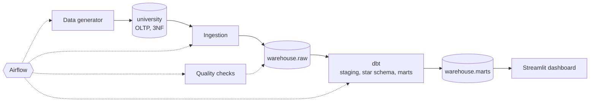
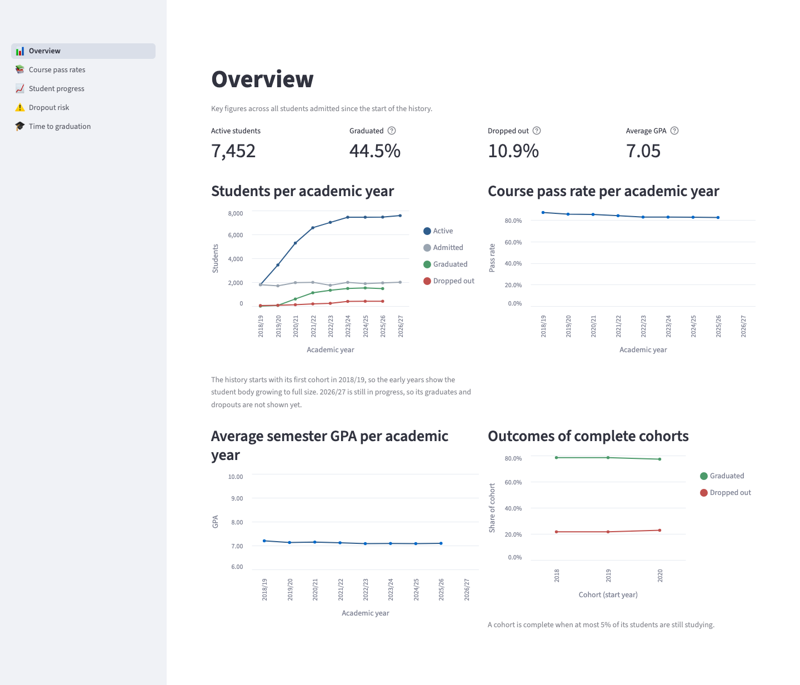
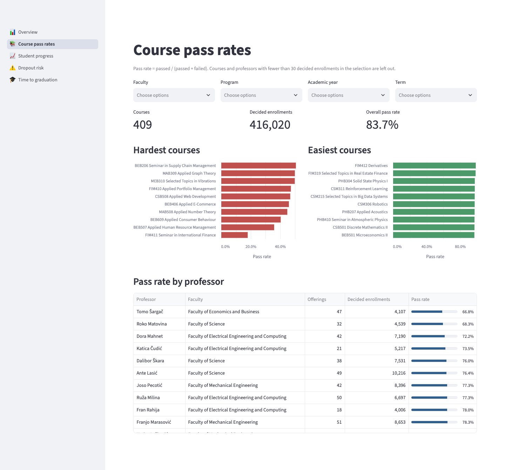

# Academic Data Platform

An end-to-end data engineering project that models a university's operational system and turns it into an analytical data warehouse, with daily incremental loads, data quality checks, orchestration and a dashboard.

## Background

The idea for this project comes from my university studies. Several courses each covered one piece of the same puzzle:

- **Databases**: relational modelling, normalization, constraints, SQL
- **Programming in Python**: writing structured, testable programs
- **Data Warehousing and Business Intelligence**: dimensional modelling, ETL, reporting
- **Software Engineering**: version control, testing, project organization
- **Operating Systems and Computer Networks**: processes, containers, client–server communication

In the courses these topics were taught separately, each with its own small exercises. I wanted to see how they fit together in a single, realistic system, so I decided to combine them into one project and build it in my free time as a hobby. I chose a university as the domain because it is a system I know well from the inside.

## The problem

A university's operational database records students, programs, courses, enrollments and exam results. It is designed for day-to-day transactions: registering a student, enrolling them in a course, recording a grade. It is not designed for analysis.

Faculty and administration ask questions such as:

- Which courses have the highest failure rates, and is it the course or the semester?
- How does a student's average grade develop over their studies?
- How long does it take students to graduate in each program?
- Which students show early signs of dropping out?

Answering these directly against the operational database is slow, complicated and risky, since heavy analytical queries compete with daily operations. The standard solution is to move the data into a separate analytical warehouse, modelled specifically for reporting.

## What the project builds

**1. Operational database (OLTP).**
A normalized PostgreSQL schema (3NF) covering faculties, programs, students, professors, courses, prerequisites, semesters, course offerings, enrollments and exam attempts. Business rules live in the database itself, as foreign keys, check constraints, an exclusion constraint and triggers. For example, a student cannot enroll in a course without having passed its prerequisites. Seven Alembic migrations version the schema.

**2. Synthetic data generator.**
Real student data is private, so a seeded Python generator simulates eight years of university life: student cohorts, grades from a model of student ability and course difficulty, failed exams and retakes, program transfers, dropouts and graduations. A daily mode then advances a simulation clock one day at a time, with new enrollments, exams, corrections and the occasional delete. That gives the pipeline real incremental work to do.

**3. Ingestion pipeline.**
A Python pipeline copies new and changed rows from the operational database into the warehouse's raw layer:
- **Incremental and safe to repeat.** Loads read from a watermark with an overlap window, and re-running a window never creates duplicates.
- **Deletes are detected** by comparing keys.
- **Schema drift** is handled: new source columns appear in raw automatically.
- **Tracked.** Every batch is recorded with its counts and watermark.

**4. Data warehouse.**
SQL transformations with dbt turn the raw data into a dimensional model:
- a **star schema** with incremental fact tables for enrollments and exam attempts, and dimensions for students, courses, professors, programs, semesters and dates;
- a **Type 2 slowly changing dimension** for students, built from the business dates of their program history;
- **reporting marts** for pass rates, GPA trends, student numbers per year, time to graduation and dropout risk.

**5. Data quality and orchestration.**
- **Tests at every layer.** 170 dbt tests check keys, relationships, ranges and business rules. A failing test stops the models built on it.
- **Cross-system checks.** A Python reconciliation compares row counts across the source, raw and staging, and freshness checks watch the raw tables.
- **Scheduled.** Apache Airflow runs the chain every day: simulate, ingest, transform, check.

**6. Dashboard.**
A Streamlit dashboard presents the results to the people who need them: overall figures and yearly trends, course pass rates by faculty, program, year and professor, a student's progress against their cohort, dropout risk, and time to graduation. It reads only the reporting marts, through a read-only database role.

## Architecture



Every component runs in Docker Compose on one PostgreSQL server, which holds separate databases for the operational system, the warehouse and Airflow. The whole platform starts with a single Compose command. On an empty database it generates a history, loads it and builds the warehouse before the scheduler and the dashboard start. The full diagram and the list of services are in [docs/architecture.md](docs/architecture.md).

## Results

Measured on a laptop with PostgreSQL in Docker, with the default history of 15,000 students over eight academic years.

| | |
|---|---|
| Operational database (history plus the first simulated days) | 1.0 million rows: 17,000 students, 425,000 enrollments, 540,000 exam attempts |
| History simulation and load | 8 s to simulate, 4.7 min to load with every constraint and trigger enabled |
| Full ingestion into the raw layer | 1.0 million rows in 68 s |
| Incremental ingestion after 30 simulated days | 27 s; 109 changed rows loaded and 10 deletes detected |
| Warehouse build (`dbt build`, 28 models and 170 tests) | 31 s from scratch |
| Daily Airflow run (simulate, ingest, build, check) | 38 s on an ordinary day, 132 s on the first day of the academic year |
| Dashboard queries | under 0.15 s per page, uncached |
| Tests | 190 Python tests, 170 dbt tests, 10 DAG tests; every push runs the whole chain on a fresh database in CI |
| Simulated outcomes | 77% of complete cohorts graduate, 12% of all students drop out, 4% transfer |





Screenshots of all five pages are in [docs/images](docs/images).

## Key design decisions

- **3NF for the operational side, star schema for the analytical side.** Each model suits its workload: normalization protects data integrity during writes, a dimensional model keeps analytical queries simple and fast.
- **Business rules in the database, not only in code.** Constraints and triggers guarantee consistency no matter which application writes the data, and a successful load proves the generated data obeys every rule.
- **Incremental, idempotent loading.** Pipelines fail and get re-run, so every load is safe to repeat.
- **History from business dates.** The student dimension follows the dates on which students joined and left programs, never the time the data happened to be loaded.
- **Least privilege.** The dashboard connects with a role that can only read the reporting marts.
- **Reproducible.** The whole platform runs in containers, and generated data is deterministic for a given seed and dependency versions.

## Lessons learned

**Load order matters when triggers check other rows.** The prerequisite trigger checks, at insert time, that a student has already passed the prerequisites. Loading all enrollments before all exam attempts therefore rejected every course with prerequisites. The history is now loaded period by period, in the order it happened. Measuring the load also showed that 96% of its time goes to per-row checks: 3 s with all triggers off against 79 s with them on. They stay on deliberately; the trade-off is documented.

**The query planner needs to be able to estimate.** The staging views first selected the latest version of each row with `ROW_NUMBER() = 1`. PostgreSQL estimates such a filter at 0.5% of the rows, so it planned a nested-loop join for what were really 450,000 rows. One relationships test took 132 s. Rewriting the views with `DISTINCT ON`, which returns the same rows but is estimated from column statistics, brought that test under a second and a full daily run from 364 s down to 38 s.

**Quality checks test the data, including data you generated yourself.** A plausibility warning flagged 234 course offerings with a pass rate above 99%. The pipeline was correct; the generator was too generous, letting almost everyone pass an easy course over three exam terms. Adding students who never sit the exam and students who give up after two failures brought the count down to 18, the occasional genuinely easy course.

**Choose where history comes from.** A dbt snapshot would only have recorded changes from its first run onwards, although the source already held every student's complete program history, with real dates. Building the Type 2 dimension from those business dates gives correct history from the first day, rebuilds identically, and does not depend on how often the pipeline runs.

## Possible improvements

- **Statement-level business-rule triggers** with transition tables: one set-based check per bulk load instead of one query per row.
- **Change data capture** (logical replication or Debezium) instead of watermarks and key comparison, to capture every change and every delete without scanning.
- **Delete detection only where deletes can happen**, or less often. Today it scans the keys of every table on every run.
- **Partitioned fact tables**, and incremental marts as the history grows.
- **A status history in the source**, so suspensions and reinstatements can be analysed over time.
- **Real authentication** for Airflow and the dashboard, and secrets from a secret store instead of environment files.

## Tech stack

| Area | Tools |
|---|---|
| Language | Python 3.11 |
| Database | PostgreSQL 16 |
| Database access and migrations | SQLAlchemy 2, psycopg 3, Alembic |
| Data generation | Faker and a seeded simulation |
| Transformations and data tests | dbt Core with dbt-postgres |
| Orchestration | Apache Airflow 3 (LocalExecutor) |
| Dashboard | Streamlit, Altair |
| Infrastructure | Docker, Docker Compose |
| Quality | pytest, ruff, GitHub Actions |

## Repository structure

```
academic-data-platform/
├── src/academic_platform/   Shared configuration and database access
├── db/migrations/           Operational schema migrations
├── docker/init/             First-start script for the warehouse database
├── generator/               Synthetic history and daily simulation
├── ingestion/               Operational database to raw layer pipeline
├── dbt/                     Warehouse models, tests and macros
├── quality/                 Cross-layer reconciliation checks
├── orchestration/           Airflow image, DAGs and their tests
├── dashboard/               Streamlit app, its image and read-only role
├── docs/                    Architecture, ERDs, design notes and screenshots
└── tests/                   Python tests
```

## Documentation

- [Architecture and services](docs/architecture.md)
- [Operational database](docs/design_oltp.md) and its [ERD](docs/erd_oltp.md)
- [Data generator](docs/design_generator.md)
- [Ingestion](docs/design_ingestion.md)
- [Warehouse](docs/design_warehouse.md) and its [ERD](docs/erd_warehouse.md)
- [Data quality](docs/design_quality.md)
- [Orchestration](docs/design_orchestration.md)
- [Dashboard](docs/design_dashboard.md)

## Roadmap

- [x] Project foundation, containerized database, continuous integration
- [x] Operational schema design (3NF) and migrations
- [x] Synthetic data generator
- [x] Incremental ingestion pipeline
- [x] Warehouse: staging layer, star schema, SCD Type 2
- [x] Data quality tests
- [x] Orchestration
- [x] Dashboard
- [x] Documentation: architecture, ERDs and design notes

## License

MIT
