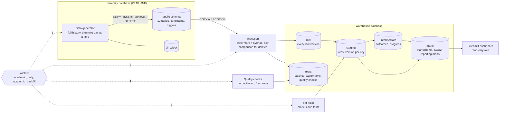

# Architecture

The platform turns the operational database of a simulated university into an analytical warehouse and a dashboard. Every step runs in containers on one PostgreSQL server, orchestrated by Airflow.

## Flow

1. **Generate.** The generator writes a seeded history of the university into `university.public`: faculties, programs, courses, students, enrollments and exam attempts. In daily mode it then adds one simulated day at a time, with ordinary inserts, updates and deletes. Constraints and triggers check every row. [design_oltp.md](design_oltp.md), [design_generator.md](design_generator.md)
2. **Ingest.** Changed rows are copied into `warehouse.raw`, using a watermark with an overlap window. Every version is kept, deletes are found by comparing keys, and each table loads in its own transaction. [design_ingestion.md](design_ingestion.md)
3. **Transform.** dbt builds staging views, intermediate tables, a star schema with a Type 2 student dimension and incremental facts, and the reporting marts. All tests run as part of the same build. [design_warehouse.md](design_warehouse.md), [erd_warehouse.md](erd_warehouse.md)
4. **Check.** Row counts are reconciled across source, raw and staging, and raw freshness is checked. Results go to `meta.quality_checks`. [design_quality.md](design_quality.md)
5. **Present.** The dashboard reads the marts through a role that can only select from them. [design_dashboard.md](design_dashboard.md)

Airflow runs steps 1 to 4 every day, one run at a time. [design_orchestration.md](design_orchestration.md)

## Services

`docker compose up` starts the whole platform:

| Service | Image | Runs | Port |
|---|---|---|---|
| `postgres` | `postgres:16-alpine` | Always. Hosts `university`, `warehouse` and `airflow`; creates `warehouse` and its schemas on the first start | 5432 |
| `airflow-database` | `postgres:16-alpine` | Once. Creates the `airflow` metadata database if it is missing | |
| `airflow-init` | Airflow image | Once. Migrates the Airflow metadata and creates the `academic_pipeline` pool | |
| `platform-init` | Airflow image | Once. Applies the project's migrations; on an empty operational database it also generates a history (`PLATFORM_STUDENTS`, default 15,000), ingests it and builds the warehouse | |
| `airflow-apiserver` | Airflow image | Always. Airflow UI, REST API and execution API | 8080 |
| `airflow-scheduler` | Airflow image | Always. Schedules the DAGs and runs their tasks (LocalExecutor) | |
| `airflow-dag-processor` | Airflow image | Always. Parses the DAG files | |
| `dashboard-access` | Dashboard image | Once. Creates the read-only `dashboard_reader` role and its grants | |
| `dashboard` | Dashboard image | Always. The Streamlit app | 8501 |

**Start order.** Compose dependencies set the order:
1. `postgres` becomes healthy.
2. The Airflow metadata database is created and migrated.
3. `platform-init` prepares the project databases.
4. The scheduler and the reader role follow.
5. The dashboard starts last.

**Data survives restarts.** Data lives in two named volumes: `pgdata` for the databases and `airflow-logs` for task logs. A second `docker compose up` finds the data and skips generation.

**Images.**
- **The Airflow image** (`orchestration/Dockerfile`) adds the project, dbt, the migrations and the bootstrap script to the official Airflow image. They live in their own virtualenv.
- **The dashboard image** (`dashboard/Dockerfile`) installs only the core package and its `dashboard` extra.

## Repository map

| Path | Component |
|---|---|
| `src/academic_platform` | Shared configuration and database access |
| `db/migrations` | Alembic migrations of the operational schema |
| `generator` | Seeded history and daily simulation |
| `ingestion` | Source to raw pipeline |
| `dbt` | Warehouse models, tests and macros |
| `quality` | Cross-layer reconciliation |
| `orchestration` | Airflow image, DAGs and their tests |
| `dashboard` | Streamlit app, its image and the reader role |
| `docker/init` | First-start script for the warehouse database |
| `tests` | Python tests for every package |
