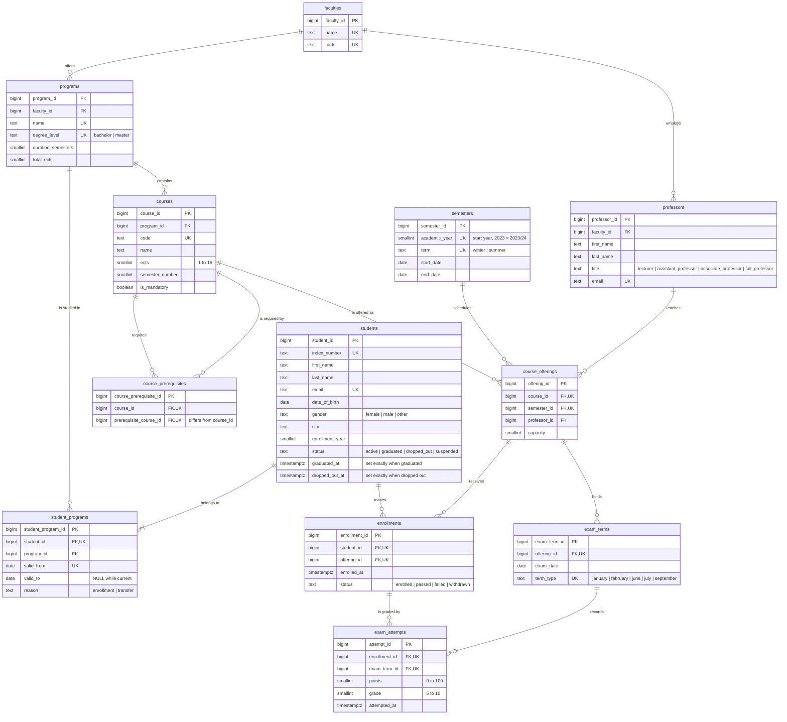

# OLTP entity relationship diagram

Operational database `university`, schema `public`. The reasoning behind the model is in [design_oltp.md](design_oltp.md).

Every primary key is a `bigint GENERATED BY DEFAULT AS IDENTITY` column. Every table also has `created_at` and `updated_at` (`timestamptz`); they are left out of the diagram for readability. `UK` marks a column that is part of a unique business key.

The simulation clock `sim.clock` lives in a separate schema and has no relationships; it is described in [design_generator.md](design_generator.md).

## Cardinalities

| Relationship | Cardinality | Enforced by |
|---|---|---|
| faculty → programs, professors | one to zero or many | FK |
| program → courses, student_programs | one to zero or many | FK |
| student → student_programs | one to one or many | FK; "at least one" is guaranteed by the writing application, not the database |
| course → course_prerequisites (both sides) | one to zero or many | two FKs, unique pair |
| course, semester, professor → course_offerings | one to zero or many | FK; one offering per course and semester |
| student, course offering → enrollments | one to zero or many | FK; one enrollment per student and offering |
| course offering → exam_terms | one to zero or many | FK; one term of each type per offering |
| enrollment, exam term → exam_attempts | one to zero or many | FK; one attempt per enrollment and term |
