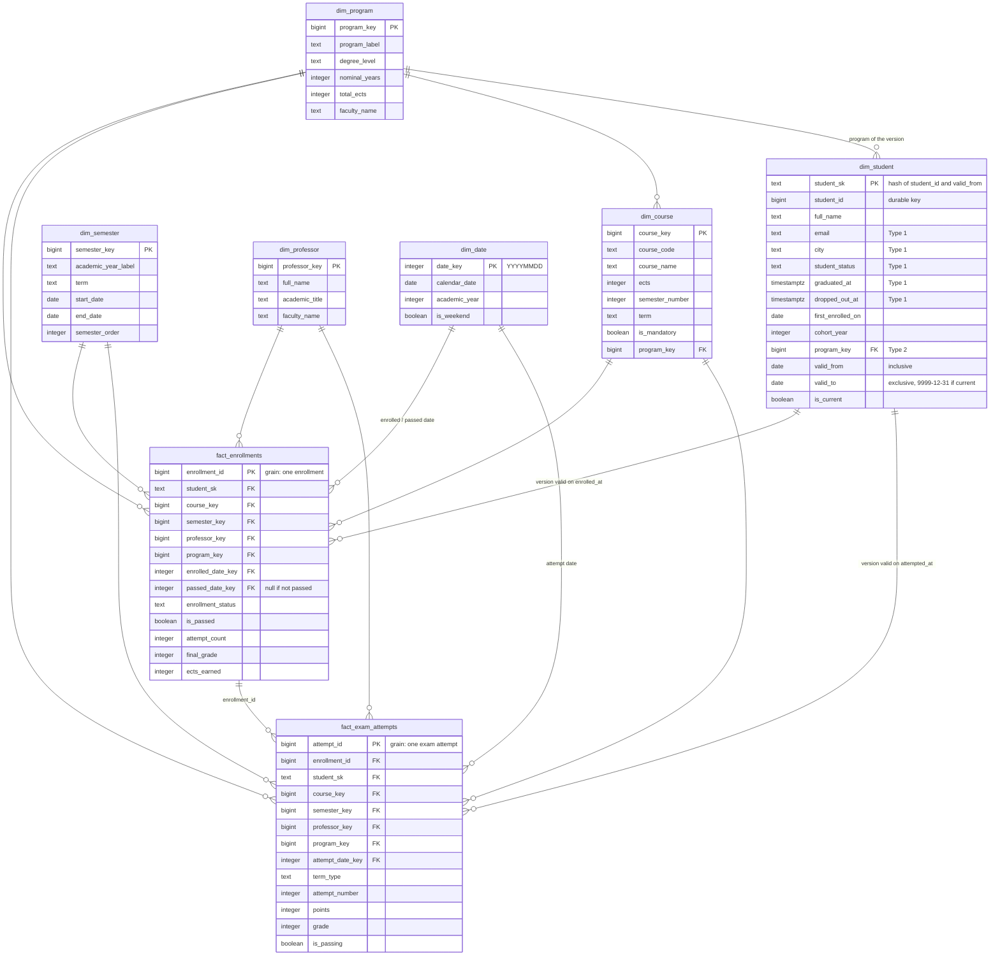

# Warehouse entity relationship diagram

Star schema in `warehouse.marts`, built by dbt from the raw layer. The design is explained in [design_warehouse.md](design_warehouse.md).



## Reporting marts

The marts sit on top of the star schema in the same `marts` schema:

| Mart | Grain | Built from |
|---|---|---|
| `mart_course_pass_rates` | course, semester and professor | `fact_enrollments`, `fact_exam_attempts`, dimensions |
| `mart_course_pass_rates_by_year` | course and academic year | `fact_enrollments`, `fact_exam_attempts`, `dim_course`, `dim_semester` |
| `mart_student_gpa_trend` | student and semester | `int_student_semester_progress`, `dim_student`, `dim_semester` |
| `mart_student_population_by_year` | academic year | `dim_student`, `dim_semester` |
| `mart_time_to_graduation` | program and cohort | `dim_student`, `dim_program` |
| `mart_dropout_risk` | active student | `int_student_semester_progress`, `dim_student` |

## Layers

```
raw.*  ──▶  staging.stg_*  ──▶  intermediate.int_*  ──▶  marts.dim_* / marts.fact_*  ──▶  marts.mart_*
(every version)  (latest version,      (enrollment outcomes,       (star schema)              (reporting)
                  deletes removed)      semester progress)
```
